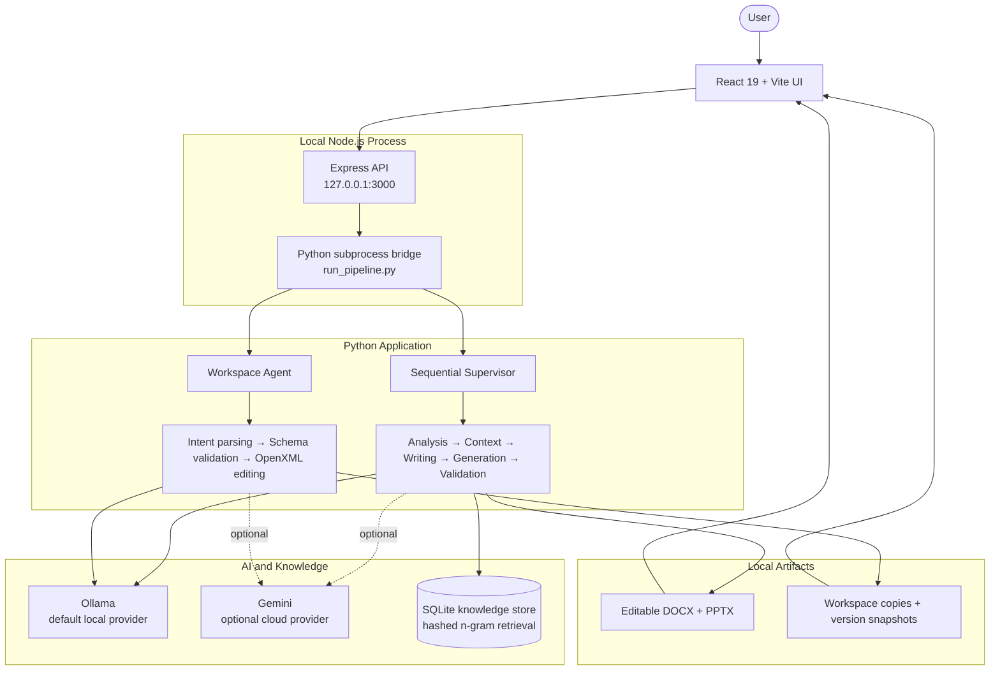
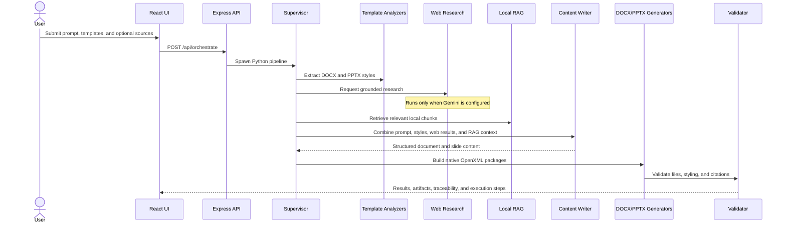
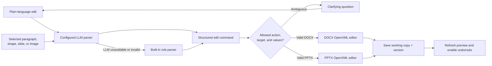

# Agentic Doc Studio

**Repository:** `agentic-doc-studio`

[](LICENSE)

A local-first AI workspace for generating, analyzing, and conversationally editing editable Microsoft Word (`.docx`) and PowerPoint (`.pptx`) files. The project combines a React interface, an Express API, a sequential Python agent pipeline, retrieval-augmented generation, and deterministic OpenXML editing.

> **Project status:** functional MVP/academic proof of concept. It is intended for local evaluation and portfolio demonstration, not production or untrusted multi-user deployment. See [Project Status](docs/PROJECT_STATUS.md) for the audited readiness assessment.

## Key Features

- Generates editable Word documents and 12-slide PowerPoint decks from natural-language requests and supplied templates.
- Coordinates specialized modules for ingestion, document and presentation analysis, research, retrieval, writing, generation, and validation.
- Provides a split-screen editor with chat, live document previews, targeted edits, version history, undo, redo, and download.
- Converts between DOCX and PPTX formats.
- Ingests DOCX, PPTX, PDF, text, Markdown, and common image formats for analysis or retrieval.
- Preserves source traceability through web and local-RAG citation records.
- Runs locally with Ollama by default; Gemini is an optional cloud provider and enables live Google Search grounding.
- Builds Office files directly with OpenXML, without requiring Microsoft Office on the server.

## Architecture



The generation workflow is a sequential, modular multi-agent pipeline rather than a distributed autonomous-agent system. The TypeScript server starts `run_pipeline.py` for backend operations. Generation requests pass through the supervisor; workspace edits use a dedicated editor path.

Editing requests are converted into a constrained JSON command, validated against an allowlist, and applied to a working copy of the Office file. The original input is not modified.

## Multi-Agent Architecture

The supervisor coordinates a fixed sequence of focused Python modules. These modules have agent-style responsibilities, but they do not communicate asynchronously or use a dynamic planning graph.

| Stage | Components | Responsibility |
|---|---|---|
| Orchestration | Supervisor | Runs the generation stages in order, records execution steps, and persists session state |
| Analysis | Document Analyzer, PPT Analyzer | Extracts document and presentation style information from the selected templates |
| Knowledge | Ingestion Agent, Web Research Agent, RAG Agent | Parses uploaded material, optionally gathers grounded web results, and retrieves relevant local chunks |
| Synthesis | Content Writer | Produces structured document sections and slide content with the configured LLM |
| Output | Document Generator, PPT Generator | Builds native DOCX and PPTX packages using the extracted styles |
| Quality | Validation Agent | Checks package validity, presentation structure, styling, and citation coverage |
| Utilities | Conversion Agent | Converts generated content between DOCX and PPTX representations |
| Editing | Workspace Agent, intent parsers, OpenXML editors | Resolves conversational requests into validated, targeted edits with version history |

### Generation Sequence



## Current Capabilities

| Area | Implemented behavior |
|---|---|
| Generation | Template-aware DOCX and 12-slide PPTX creation |
| Word editing | Text updates, replacement, insertion and deletion; paragraph operations; font, emphasis, color, size, and alignment changes; image replacement and resizing |
| PowerPoint editing | Text and bullet updates; slide deletion; text addition; style and background updates; image replacement, resizing, and movement |
| Retrieval | Local SQLite knowledge store with hashed n-gram vectors and cosine similarity |
| Research | Live Google Search grounding when Gemini is configured; skipped in default Ollama mode |
| OCR | Image analysis through the configured Ollama vision model or Gemini vision |
| History | Workspace snapshots, undo, redo, restore, and downloadable edited copies |
| Conversion | DOCX to PPTX and PPTX to DOCX |

The local retrieval implementation is intentionally lightweight and is not equivalent to a production semantic-embedding/vector-database stack.

### Conversational Editing Flow



## Technology Stack

- **Frontend:** React 19, TypeScript, Vite, Tailwind CSS
- **API:** Express 4 on Node.js
- **Backend:** Python standard library plus `pypdf`
- **AI providers:** Ollama by default; optional Google Gemini
- **Document engine:** native OpenXML package parsing and generation
- **Persistence:** SQLite and local filesystem
- **Testing:** Python `unittest` and TypeScript compiler checks

## Prerequisites

- Node.js compatible with Vite 8
- Python 3
- npm
- For the default local setup: [Ollama](https://ollama.com/) with `qwen3:4b` and, for image OCR, `qwen3-vl:8b`
- For the optional cloud setup: a Gemini API key

## Quick Start

### 1. Install dependencies

```powershell
npm install
python -m venv .venv
.\.venv\Scripts\Activate.ps1
python -m pip install -r requirements.txt
```

On macOS or Linux, activate the environment with `source .venv/bin/activate`.

### 2. Configure the application

```powershell
Copy-Item .env.example .env
```

The example configuration selects Ollama and contains no real credentials. Pull the default models once:

```powershell
ollama pull qwen3:4b
ollama pull qwen3-vl:8b
```

To use Gemini instead, set `AI_PROVIDER=gemini` and provide `GEMINI_API_KEY` in your local `.env`. Never commit `.env`, API keys, or other credential files.

### 3. Run the development server

```powershell
npm run dev
```

Open <http://127.0.0.1:3000>. The server intentionally binds to localhost because the current API has no authentication.

## Common Commands

```powershell
# TypeScript validation
npm run lint

# Production build
npm run build

# Python test suite
python -m unittest discover -s tests -v

# Rebuild the editor demo files
python -m templates_and_samples.create_demo_files
```

The test suite mocks model calls, so it does not require an API key or a running Ollama instance.

## Demo Workflow

1. Start Ollama and run the development server.
2. Open the **Chat & Orchestrator** tab and optionally upload trusted source material.
3. Select the bundled or uploaded DOCX and PPTX templates.
4. Enter a generation request. The supervisor analyzes the templates, gathers available context, writes structured content, builds both Office files, and validates the results.
5. Review the generated artifacts and their citation traceability.
6. Open a generated or uploaded file in the **AI Editor Workspace**.
7. Select a paragraph, text box, slide element, or image and enter a plain-language edit request.
8. Review the new version, exercise undo/redo, and download the edited native Office file.

With the default Ollama configuration, the workflow uses uploaded/local knowledge and skips live web search. Configure Gemini to demonstrate live Google Search grounding. A presenter-oriented walkthrough is available in [Demo Script](docs/DEMO_SCRIPT.md).

## Repository Layout

```text
.
├── agents/                 # Pipeline agents, edit parsing, and workspace coordination
├── core/                   # OpenXML, previews, LLM adapters, RAG, citations, and versions
├── docs/                   # Audited architecture, API, security, testing, and project docs
├── scripts/                # Project packaging utility
├── src/                    # React/TypeScript frontend
├── templates_and_samples/  # Versioned templates, demo files, and sample knowledge
├── tests/                  # Python unit and integration tests
├── run_pipeline.py         # JSON bridge between Express and Python
├── server.ts               # Local Express API and Vite host
└── .env.example            # Safe configuration template
```

Runtime output, uploads, workspace versions, the local knowledge database, environments, and local secrets are excluded from version control.

## API Overview

The UI uses the local API exposed by `server.ts`. Principal routes include:

| Method | Route | Purpose |
|---|---|---|
| `GET` | `/api/status` | Provider, knowledge-base, and version status |
| `POST` | `/api/orchestrate` | Run the document and presentation generation pipeline |
| `POST` | `/api/upload` | Upload and ingest a supported source file |
| `POST` | `/api/convert` | Convert between DOCX and PPTX |
| `POST` | `/api/workspace/open` | Open an existing DOCX or PPTX in the editor |
| `POST` | `/api/workspace/chat` | Apply a conversational edit |
| `POST` | `/api/workspace/undo` | Restore the previous workspace version |
| `POST` | `/api/workspace/redo` | Reapply the next workspace version |
| `GET` | `/api/workspace/download` | Download the active edited file |

See [API Documentation](docs/API_DOCUMENTATION.md) for request examples and security notes.

## Documentation

- [Master Project Documentation](docs/MASTER_PROJECT_DOCUMENTATION.md)
- [Architecture](docs/ARCHITECTURE.md)
- [AI Agent Documentation](docs/AI_AGENT_DOCUMENTATION.md)
- [API Documentation](docs/API_DOCUMENTATION.md)
- [RAG Documentation](docs/RAG_DOCUMENTATION.md)
- [Security Documentation](docs/SECURITY_DOCUMENTATION.md)
- [Testing and Evaluation](docs/TESTING_AND_EVALUATION.md)
- [Deployment and DevOps](docs/DEPLOYMENT_DOCUMENTATION.md)
- [Current vs. Production Architecture](docs/CURRENT_VS_PRODUCTION.md)
- [Project Status and Scorecard](docs/PROJECT_STATUS.md)
- [Demo Script](docs/DEMO_SCRIPT.md)
- [Interview Preparation](docs/INTERVIEW_PREPARATION.md)
- [Documentation Audit](docs/DOCUMENTATION_AUDIT.md)

## Security Notes

- Local configuration belongs in `.env`; only the placeholder-based `.env.example` should be committed.
- `keys.txt`, private-key files, uploads, generated outputs, local versions, and the SQLite knowledge store are ignored.
- The server binds to `127.0.0.1` because the API does not implement authentication.
- Uploaded Office and image files should be treated as untrusted input and restricted to local evaluation.

## Current Limitations

- There is no authentication, authorization, RBAC, or per-user isolation.
- Files and workspace state are stored locally and are not encrypted by the application.
- Uploaded content is selected by file extension and is not malware-scanned.
- The Express process launches Python subprocesses, and the shared local state is not designed for horizontal scaling.
- Orchestration follows a static sequence rather than a dynamic planner or agent graph.
- Local RAG uses hashed n-gram vectors rather than learned semantic embeddings.
- Live web research requires the optional Gemini provider and is unavailable in default Ollama mode.
- Prompt injection and RAG-poisoning defenses are not production-grade.

Keep the service bound to localhost and use only trusted files. Review [Security Documentation](docs/SECURITY_DOCUMENTATION.md) before deployment work.

## Future Improvements

- Replace per-request Python subprocesses with a persistent backend service and asynchronous job queue.
- Add authentication, authorization, per-user isolation, and encrypted object storage.
- Upgrade retrieval to hybrid keyword and semantic search backed by a production vector database.
- Add dynamic workflow routing, retries, observability, and evaluation traces.
- Strengthen upload validation, XML hardening, malware scanning, prompt-injection defenses, and RAG ingestion controls.
- Add claim-level citation mapping and a representative offline evaluation dataset.
- Package the stack for reproducible container-based deployment and CI/CD.

## License

Licensed under the [MIT License](LICENSE).
