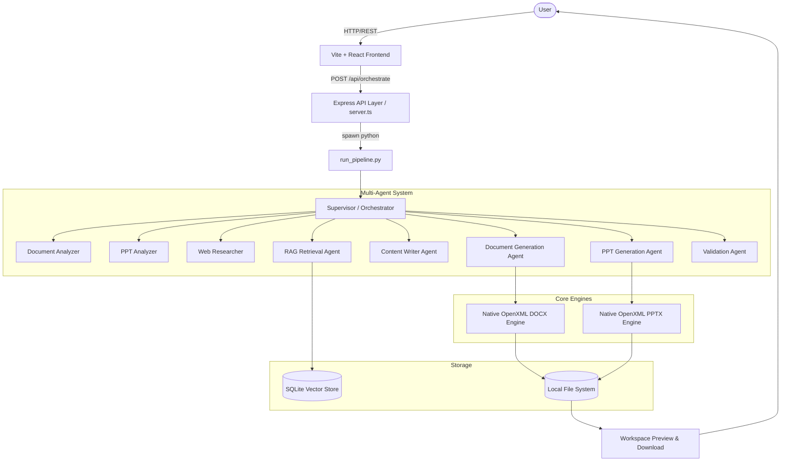
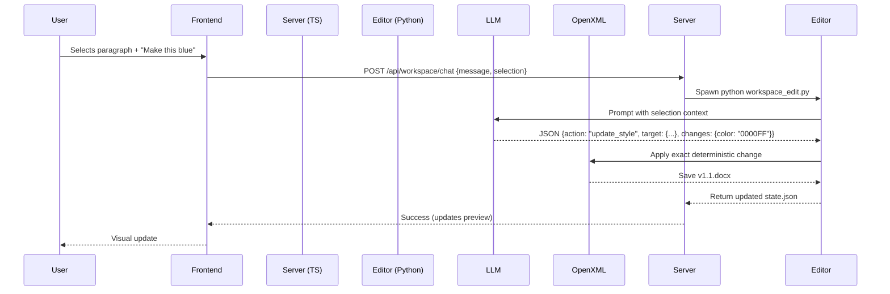

# System Architecture

## High-Level Architecture

## Conversational Editing Data Flow

## Storage Architecture
- **Vector Store**: Currently local SQLite (`knowledge_store.db`).
- **File System**: `templates_and_samples/uploads` for ingest, `output/` for generated files, `output/workspace/` for live editing versions.
- **State**: Ephemeral session state stored in `output/session.json`.

## Production Recommendation
For enterprise production, the architecture must evolve:
1. **API Layer**: Migrate Python bridge from `child_process.spawn` to a dedicated FastAPI microservice to avoid cold-start overhead.
2. **Storage**: Replace local SQLite with Pinecone/pgvector. Replace local filesystem with AWS S3 / Azure Blob Storage.
3. **Queueing**: Add Celery or Redis for long-running generation tasks to prevent HTTP timeouts.
